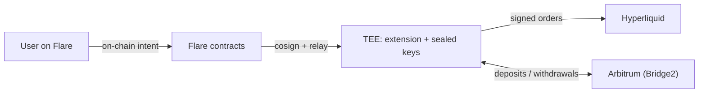
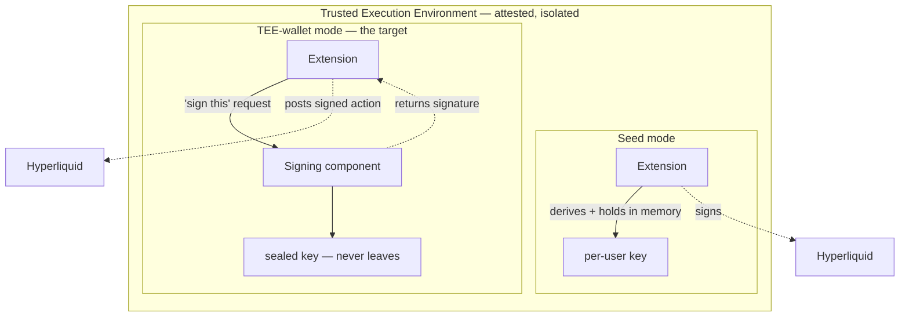
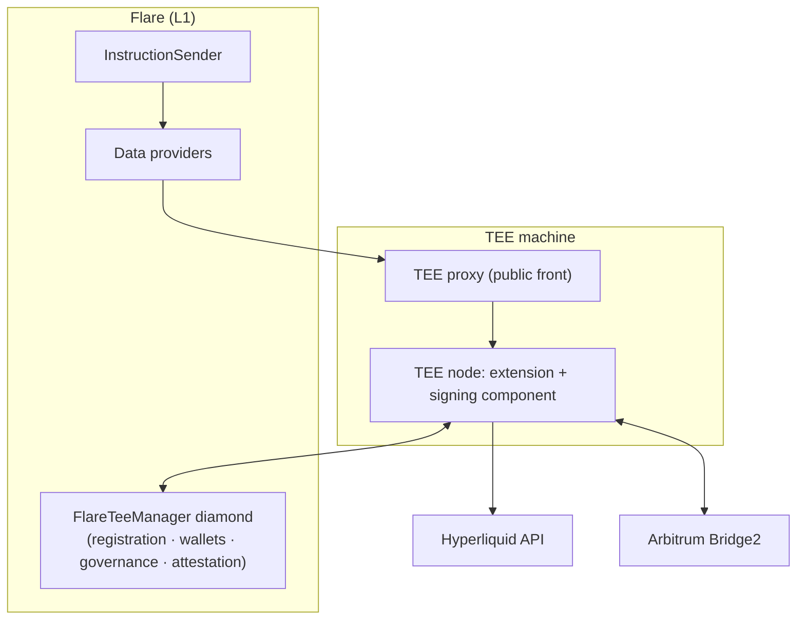
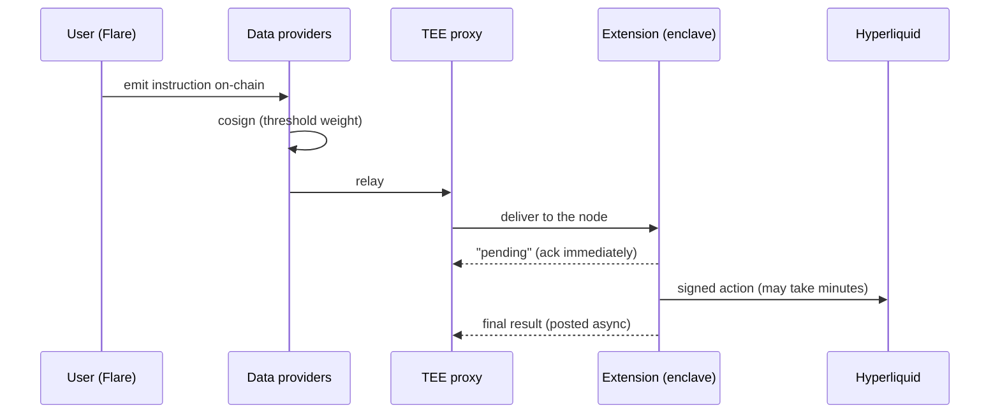
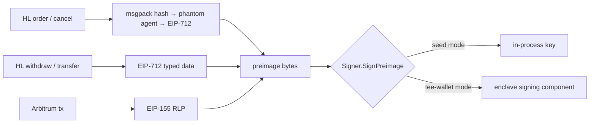
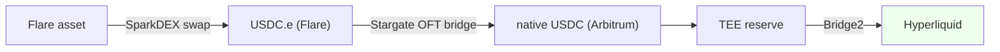
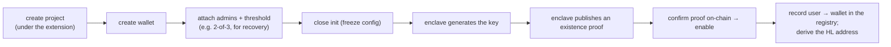

# hype-accounts — Architecture

A systems-level explanation of **what this is, how it works, and why it's safe** — the
design and the reasoning, illustrated with diagrams and a few focused snippets, rather than
a code tour. For *where each component stands* (proven / deferred / blocked) see
[`STATUS.md`](STATUS.md); for the mainnet rollout see [`mainnet-runbook.md`](mainnet-runbook.md);
for a map from these concepts to the actual packages, see the [code map](#appendix-code-map).

## Contents
1. [What we're building](#1-what-were-building)
2. [The trust & security model](#2-the-trust--security-model)
3. [How the system fits together](#3-how-the-system-fits-together)
4. [Acting as the user without ever holding their key](#4-acting-as-the-user-without-ever-holding-their-key)
5. [How orders reach Hyperliquid](#5-how-orders-reach-hyperliquid)
6. [How money moves: the funding path](#6-how-money-moves-the-funding-path)
7. [Keeping honest books](#7-keeping-honest-books)
8. [Bringing a TEE wallet into existence](#8-bringing-a-tee-wallet-into-existence)
9. [What's proven, what's open](#9-whats-proven-whats-open)
10. [Design principles](#10-design-principles)
11. [Appendix: the knobs & the code map](#appendix-the-knobs--the-code-map)

---

## 1. What we're building

A service that lets a user on **Flare** own and operate a **Hyperliquid (HL)** trading
account — deposit, place and cancel orders, withdraw — **without ever handling the private
key that controls that account, and without trusting the operator who runs the service.**
The key is created and used inside a **Trusted Execution Environment (TEE)**; the user
drives it with on-chain instructions; the executing code is itself attested and registered
on-chain, so anyone can verify that the thing holding the funds is exactly the reviewed
code and nothing else.



Think of it as a **programmable, verifiable custodian**: the user says "buy 0.1 ETH," that
intent travels on-chain, a network of validators relays it into the enclave, and the enclave
signs the corresponding order with a key no human can extract. Everything below serves two
goals — **the user's funds are safe even from the operator**, and **the books always reflect
reality.**

---

## 2. The trust & security model

This is the heart of the design, so it comes first.

### Where the keys live

Every user has their own Hyperliquid account, controlled by a secp256k1 key. That key lives
in one of two places, chosen by configuration:



- **Seed mode** — the extension holds one master secret (inside the TEE) and
  deterministically derives a distinct key per user. Per-user keys exist only in the
  enclave's memory, only while needed. Simple; everything is one process.
- **TEE-wallet mode (the target, "PMW")** — each user's key is **generated inside the
  enclave and never leaves it.** It lives in a *separate* signing component of the TEE node,
  not in the extension's memory. The extension can *ask* it to sign a specific message but
  can never read the key. This is defense in depth: even a bug in the trading logic can't
  leak a key it was never given.

Moving between these changes nothing about behavior (§4) — TEE-wallet mode is strictly
stronger and is where the system is headed.

### What the TEE actually guarantees

Two properties matter here:

1. **Isolation** — code and data inside the enclave (keys, seed, signing logic) are shielded
   from the host OS and from whoever operates the machine. The operator runs the box but
   cannot look inside it.
2. **Attestation** — the enclave can prove *which exact code* it is running. Flare's
   contracts pin an allowed **code hash**; a node must present a valid attestation to be
   registered and to hold wallet keys. An operator therefore cannot quietly swap in a
   modified build that exfiltrates keys — a different build has a different hash and the
   network won't trust it.

Together: **you trust the reviewed code and the hardware, not the person running it.** The
registration + attestation flow is what binds "this key" to "this attested code on this
machine."

### Why an attacker — including the operator — can't steal funds

- The trading key is **never exported** in TEE-wallet mode; the extension only receives
  *signatures over specific messages*.
- The signing component is reachable only from **inside the enclave's own network** — it's
  not a public service — so "who can ask it to sign" is bounded to the attested extension.
- Instructions are **on-chain and consensus-relayed** (§3): no single operator can secretly
  inject a "withdraw everything to me" action; every action originates from an auditable
  instruction that a threshold of independent data providers agreed to relay.
- The system **verifies before it trusts a signature** (§4): it reconstructs the exact bytes
  it expects to sign and checks them against the canonical form before acting.

### An honest boundary

Two things stated plainly. First, in **seed mode** the derived key does sit in the
extension's memory (inside the enclave) while in use — its safety rests on TEE isolation of
that process; TEE-wallet mode removes even that exposure. Second, the signing component will
sign *any well-formed message it's asked to* for a wallet it holds — the boundary is
**network isolation + attestation** (only the attested extension can reach it), not a
per-message policy inside the signer. Both are deliberate, and both are why the
attestation/registration story matters as much as the enclave itself.

---

## 3. How the system fits together

### The players



- **The extension** — our code, inside the TEE, turning intents into HL actions and keeping
  the books.
- **The TEE node** — the enclave runtime hosting the extension and the **signing component**
  (which holds wallet keys). Its on-chain **identity is its enclave public key.**
- **The TEE proxy** — the public front door; feeds relayed instructions to the node, which
  itself stays behind the firewall.
- **Flare's contracts** — one "diamond" contract exposes the whole TEE-management surface
  (registering machines, creating wallets/keys, governing admins, verifying attestations).
  Trust is anchored here.
- **Hyperliquid** — the exchange, over its HTTP API.
- **Arbitrum** — where HL settles deposits/withdrawals (its Bridge2 contract). This is why
  moving money involves Arbitrum at all (§6).

### Why instructions go on-chain

A user doesn't call the extension directly — they emit an **instruction on Flare**, and a
threshold of **data providers** must cosign and relay it before the enclave acts.



This buys three things: **no unilateral operator action** (actions require on-chain origin +
validator consensus), **auditability** (a permanent record of what was requested), and
**"fire and forget"** semantics (no ordering guarantees; replay prevented by nonces; each
instruction self-authorizing). Because a deposit or withdraw can take minutes, the extension
acknowledges *pending* immediately and reports the real result once the money has moved.

---

## 4. Acting as the user without ever holding their key

The single most important idea: **the extension treats "a key" as an address plus the
ability to sign a message — nothing more.** It never assumes the key is in its own memory.
That one abstraction is what makes seed vs. TEE-wallet a *deployment decision*, not a code
change. In the code it is quite literally two methods:

```go
// The whole custody abstraction. A Signer might be a local key,
// a seed-derived key, or a key sealed in the enclave — callers can't tell.
type Signer interface {
    Address() common.Address
    SignPreimage(preimage []byte) (signature []byte, err error) // 65-byte [R‖S‖V]
}
```

### The one insight that makes it work

Notice the method is `SignPreimage` — it takes the **bytes *before* hashing**, not a
finished 32-byte digest. That's deliberate: the enclave's signer always does the hash itself
(`sign(keccak256(msg))`). By standardizing on "hand me the bytes that get hashed," a local
key and an enclave-sealed key become **completely interchangeable** — give either the same
preimage and you get the *same signature bytes back*.

Everything the system ever signs collapses to one of two preimage shapes:

```
HL action        →  preimage = 0x19 0x01 ‖ EIP-712 domainSeparator ‖ structHash
Arbitrum tx      →  preimage = RLP(nonce, gasPrice, gas, to, value, data, chainID, 0, 0)
```

So no matter what we're doing — placing an order, withdrawing to Arbitrum, funding a user —
it reduces to "build the right preimage, then `SignPreimage`," and *where* that signing
happens is just routing:



This isn't a hope — it's **verified byte-for-byte**. The system reproduces the enclave's
exact hash-and-sign for the local path, and tests assert equality:

```
rawSigner.SignPreimage(p)      ==  crypto.Sign(keccak256(p), key)   // local == the primitive
teeWalletSigner.SignPreimage(p) ==  rawSigner.SignPreimage(p)        // sealed == local, same key
```

So "switch a user from a locally-derived key to a TEE-sealed key" provably changes *nothing*
about what lands on the wire.

### Guarding against signing the wrong thing

Signatures are dangerous because a subtly-wrong input still produces a valid-looking
signature — over the wrong data, recovering to the wrong account. So before trusting an
Arbitrum signature the system **reconstructs the exact bytes it means to sign and checks them
against the canonical encoding**, refusing to sign on a mismatch:

```
preimage = RLP(nonce, gasPrice, gas, to, value, data, chainID, 0, 0)
assert  keccak256(preimage) == the library's own tx signing hash    // else: refuse
```

That turns an entire class of "off-by-one-field" custody bugs into a loud, immediate failure.

### Why we re-implemented Hyperliquid's signing

Hyperliquid's own client library can only sign with a raw in-process key — exactly what we
refuse to hold. So the system reproduces HL's (finicky) signing scheme but routes the final
signature through the key-agnostic `Signer`. The delicate encoding pieces are copied verbatim
from HL's library and pinned to a specific version, and tests assert our output matches
theirs exactly — because if the encoding drifts by a byte, HL silently rejects the signature.

---

## 5. How orders reach Hyperliquid

Each user's HL account is addressed by their key's address. **Reads** (balances, positions,
open orders) need no key — they're just queries about an address. **Writes** need a
signature, and Hyperliquid has **two families** of them:

| Action family | Examples | How it's signed |
|---|---|---|
| **Trading (L1)** | place order, cancel, set leverage | hash a compact binary (msgpack) encoding of the action + nonce, wrap in a synthetic "agent" struct, sign as EIP-712 under a fixed *exchange* domain |
| **Account (user-signed)** | withdraw to Arbitrum, transfer USDC, spot↔perp move, switch account mode | sign directly as EIP-712 typed data under HL's *transaction* domain |

Both, as §4 showed, converge to a single `SignPreimage` call — only the domain and structure
differ. The extension builds the right structure, gets the signature, and posts
`{action, nonce, signature}` to HL's exchange endpoint. What actually goes on the wire for a
limit order is small and worth seeing once:

```json
{
  "action": {
    "type": "order",
    "orders": [{ "a": 4, "b": true, "p": "3000", "s": "0.5", "r": false,
                 "t": { "limit": { "tif": "Gtc" } } }],
    "grouping": "na"
  },
  "nonce": 1720000000123,
  "signature": { "r": "0x…", "s": "0x…", "v": 27 }
}
```

A few system-level truths hide in there: **nonces are strictly-increasing timestamps** (so
replays and out-of-order posts are rejected); **prices/sizes are formatted to HL's exact
precision rules** (the string `"3000"`, not `3000.0` — because the signature covers the
formatted bytes); a **market order** is just an aggressively-priced immediate-or-cancel order
so it fills now, while a **limit order** rests. None of this differs between seed and
TEE-wallet mode — only where the signature comes from.

---

## 6. How money moves: the funding path

Depositing to Hyperliquid isn't an HL API call — HL settles real deposits and withdrawals on
**Arbitrum**, through its Bridge2 contract. So "put $50 into my HL account" really means "get
$50 of USDC onto Arbitrum, at an address HL will credit to me, and hand it to Bridge2." That
reality shapes the whole design.

### The Arbitrum reserve, and why it exists

The system holds a **TEE-controlled reserve on Arbitrum** — USDC plus a little gas — that
**fronts** every user's deposit. The reserve exists because of one Bridge2 quirk: **it
credits the address that *sent* the USDC.** So the reserve can't deposit on a user's behalf
directly; it must first move USDC (and gas dust) to the user's *own* Arbitrum address, and
*that* address deposits — so HL credits the user, not the reserve. Withdrawals flow back into
the reserve, so it's a **recycling float hub**, not a balance that only drains.

### A deposit, end to end

```mermaid
sequenceDiagram
  participant EX as Extension
  participant R as Reserve (Arbitrum)
  participant UA as User's Arb address
  participant B2 as Bridge2
  participant HL as Hyperliquid
  EX->>R: reserve covers the amount? (else fail — nothing spent yet)
  R->>UA: send gas dust + deposit USDC
  UA->>B2: deposit USDC (Bridge2 credits the sender = the user)
  B2-->>HL: settle (~1 min)
  EX->>HL: poll until the credit actually lands
  EX->>EX: only now credit the ledger; switch to unified (first deposit only)
```

The **ordering is the safety property** — money is never committed before it's certain to be
recoverable:

```
1. ensure reserve covers it        (fail here → nothing has moved)
2. top up the user's gas
3. move USDC to the user's address
4. deposit to Bridge2, then WAIT for the real HL credit
5. if it never credits → fail, and DON'T touch the ledger
      (a late credit is reconciled later, §7 — never double-counted on retry)
6. credit the ledger; on the first-ever deposit, switch the account to "unified" mode
```

Step 6's "unified" switch merges HL's separate spot and perp balances into one collateral
pool, so a single deposit backs any kind of trade. It has to happen *after* the first deposit
— HL rejects the switch on an account that has never been funded (a lesson learned live).

A **withdrawal** is the mirror image: debit the books first, tell HL to `withdraw3` to the
reserve's Arbitrum address (a few minutes, minus a small fixed fee), and refund the books if
HL rejects it.

### The Flare front of the pipeline

The reserve holds USDC on Arbitrum, but the user's money starts on **Flare**. Bridging it is
two hops:



Both hops — a **swap** (on SparkDEX, a Uniswap-V3-style DEX on Flare) into a bridgeable
stablecoin, then a **Stargate/LayerZero** bridge that delivers *native* USDC (exactly what
Bridge2 accepts) — have **built and tested client code**, but are **not yet wired into the
live deposit handler.** Today the reserve is assumed pre-funded on Arbitrum and tops itself up
from its own HL balance when low. Finishing this front-of-pipeline is part of the mainnet
work.

### Two funding modes

- **Bridge mode** — the real path above: genuine Bridge2 deposits/withdrawals with the
  reserve.
- **Treasury mode** — a simpler legacy path for testing: deposits/withdrawals are just
  HL-internal transfers to/from a shared treasury account, sidestepping Arbitrum entirely.
  Convenient for exercising the trading logic; not how real funds should flow.

### Many users, one reserve — safely

Because one reserve key funds many users and a user may have several operations in flight,
the system serializes on two levels:

```
per-user lock   → one user's operations run one at a time   (balance + nonce consistency)
reserve lock    → all reserve spends are serialized           (shared-key nonce safety)
```

Under a burst of concurrent deposits, each is handled cleanly and independently — and the
reconciler (§7) deliberately *skips* a user who currently holds their lock, so background
bookkeeping never collides with an in-flight operation.

---

## 7. Keeping honest books

The extension keeps a lightweight **in-memory ledger** of each user's balance — fast, and
handy for answering "what's my balance" and enforcing caps. But the *truth* is on
Hyperliquid, and the two drift: deposits can credit late, trading moves P&L, every withdrawal
costs a fee. Left alone, the ledger would slowly diverge from reality.

So a **background reconciler** periodically realigns each user's ledger to their real HL
equity. The logic is small, and its safety is in what it *skips*:

```
for each user:
    if the user is mid-operation (holds their lock):  skip — catch them next round
    delta = realHLEquity(user) − ledgerBalance(user)
    if |delta| ≤ tolerance:  leave it        (float dust — ignore)
    else:                    fold delta into the ledger   (late credit, P&L, or fee)
```

The ledger is best understood as a **cache of HL's truth**, never an independent source of
it — which is exactly why the deposit handler refuses to credit on a timed-out deposit and
lets reconciliation pick up a late credit instead, so nothing is ever double-counted.

---

## 8. Bringing a TEE wallet into existence

In TEE-wallet mode a user's key isn't conjured on demand — it is **provisioned** through
Flare's on-chain wallet machinery, which is also where **governance and recovery** live:



The important design point isn't the steps — it's that a TEE-sealed trading key comes with an
**on-chain governance and recovery model baked in**, separate from the enclave that happens to
hold it. The **admins** don't trade; they're the **quorum that can recover the key** if a
machine is lost (so the key is durable, not tied to one fragile enclave). The enclave
generates the key and publishes a **proof that it exists**, which is confirmed on-chain before
the wallet is usable.

**Multiple machines.** For resilience you want the *same* key usable on more than one TEE
machine — so any node can serve a user, and a lost node doesn't strand funds. The mechanism
exists (a key can be securely replicated enclave-to-enclave, authorized by governance) and a
second node has been stood up and registered; wiring the replication itself is **deferred**
(see [`STATUS.md`](STATUS.md)). One subtlety worth knowing: a node's identity *is* its enclave
key, which can change if the enclave restarts — so a replaced node must be re-registered, and
keys are always bound to a specific, currently-attested node.

---

## 9. What's proven, what's open

Full detail and receipts in [`STATUS.md`](STATUS.md); the one-line version:

- **Working and tested on testnet:** deposits, trading (spot + perp, market + limit,
  leverage, cancel), withdrawals; real Arbitrum Bridge2 settlement; the unified-account and
  ledger/reconciliation machinery; many concurrent users; the full on-chain instruction path;
  and — the headline — a **TEE-sealed key signing real Hyperliquid orders that HL accepted,
  with the extension never holding the key.**
- **The Flare→Arbitrum bridging hops** (swap + Stargate) are proven as clients but **not yet
  wired into the live deposit path.**
- **Deferred:** replicating a key across multiple TEE machines.
- **Blocked externally:** a gasless "batched deposit" optimization that depends on a
  Hyperliquid contract that isn't deployed.
- **Not yet done:** **mainnet** — a real-funds deployment of already-proven code plus a
  Flare-mainnet deployment of the contracts, not new design.

---

## 10. Design principles

The recurring ideas behind the decisions above:

1. **Custody is a routing decision, not a code path.** Reduce "signing" to "sign these exact
   bytes," and a key can be in-process or sealed in an enclave with the rest of the system
   none the wiser — proven byte-for-byte, not assumed.
2. **Verify before you trust a signature.** Reconstruct what you mean to sign and check it; a
   wrong preimage should fail loudly, never silently sign the wrong thing.
3. **Trust the code, not the operator.** Attestation + on-chain code-hash registration make
   the thing holding funds provably the reviewed build; consensus-relayed on-chain
   instructions mean no one can unilaterally move a user's money.
4. **Reality is on Hyperliquid; the ledger is a cache.** Never let the local book become an
   independent source of truth — reconcile it to the exchange, carefully, forever.
5. **Fail before you commit funds.** Check the reserve before spending gas; wait for the real
   credit before crediting the book; refund on failure. No operation should ever strand money
   halfway.
6. **Match the counterparty exactly.** Hyperliquid's signing and encoding are unforgiving —
   reproduce them to the byte and pin the versions; drift is a silent outage.
7. **Testnet → mainnet is a config swap, not a rewrite.** Modes, addresses, and endpoints are
   configuration; the same code runs against test and real networks.

---

## Appendix: the knobs & the code map

### The knobs that matter

Two configuration switches define the *shape* of the system:

- **`HL_KEY_MODE`** — `seed` (derive keys in-process) vs `tee-wallet` (keys sealed in the
  enclave). The **custody** axis.
- **`HL_FUNDING_MODE`** — `treasury` (HL-internal transfers, for testing) vs `bridge` (real
  Arbitrum Bridge2 settlement, with the reserve). The **money-movement** axis.

The rest are operational: which HL/Arbitrum endpoints, the master seed and reserve key,
deposit caps/minimums, the reconciler cadence/tolerance, and the provisioning admin keys. Full
names/defaults live in the config source and in `.env.example`, which also carries the verified
**mainnet** addresses.

### Code map (concept → where it lives)

| Concept | Where |
|---|---|
| The key-agnostic `Signer` & per-user derivation | `internal/keys` |
| Hyperliquid account, orders, reads | `internal/hl` |
| Reproduced HL signing (the two action families) | `internal/hl/hlsign` |
| Instruction handling, funding modes, the reserve, concurrency | `internal/extension` |
| The off-chain ledger & reconciliation | `internal/ledger`, `internal/extension` |
| Arbitrum client & Bridge2 | `internal/arb` |
| Flare→Arbitrum bridging & swapping (built, not yet wired in) | `internal/stargate`, `internal/swap` |
| Configuration | `internal/config` |
| Provisioning, node registration, the on-chain e2e driver | `tools/` |

### Testing philosophy

The test strategy mirrors the trust model. The **signing equivalences are proven as unit
tests** — that a sealed key and a local key produce identical bytes, and that our HL signing
matches the reference implementation exactly — because those equalities are the foundation
everything rests on. The **behavioral logic** (deposits crediting correctly, failures never
stranding funds, reconciliation converging, many users in parallel) is tested against fakes
offline, then **re-proven live** against HL testnet and Arbitrum Sepolia. The **swap leg**,
whose real liquidity is hard to get on testnet, is proven against a *fork* of Arbitrum
mainnet. The **full on-chain path** is exercised end-to-end through the real Flare stack. The
guiding rule: anything that could silently be wrong (a signature encoding, a fund-movement
edge case) gets a test that would loudly fail if it were. See [`STATUS.md`](STATUS.md) for the
component-by-component map and the commands to run each layer.

---

*Systems architecture overview, 2026-07-09. For live status, receipts, and exact component
states, cross-check [`STATUS.md`](STATUS.md).*
